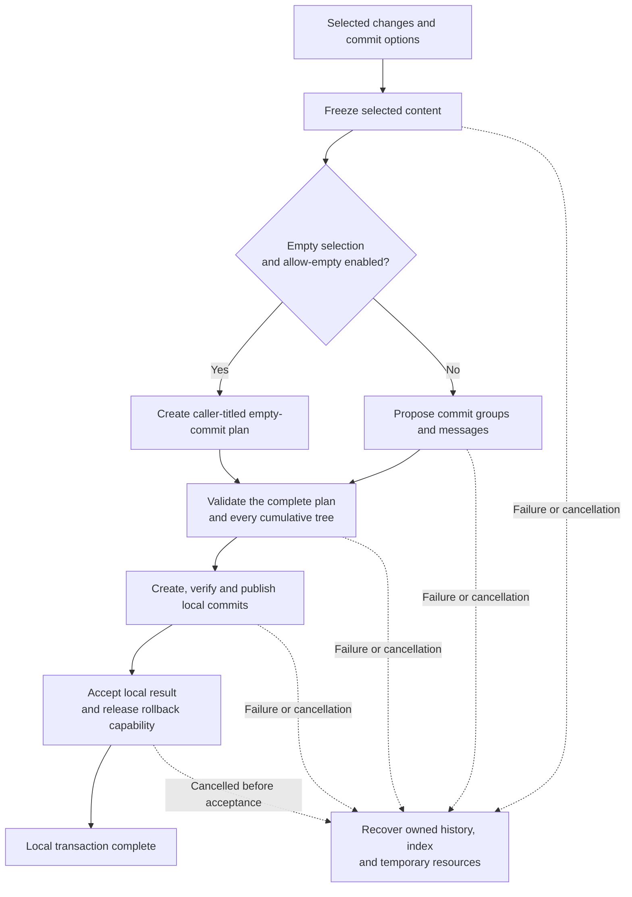
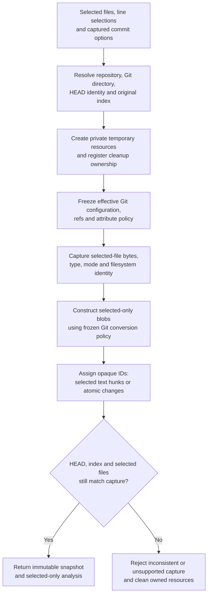
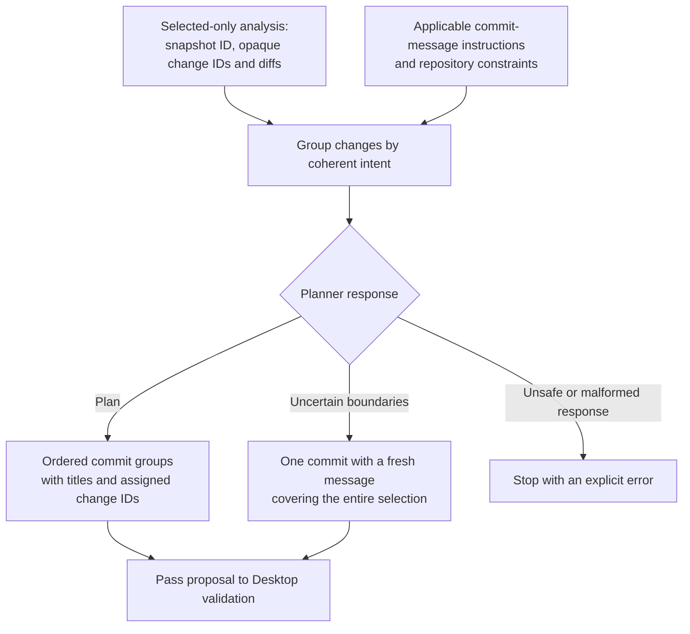
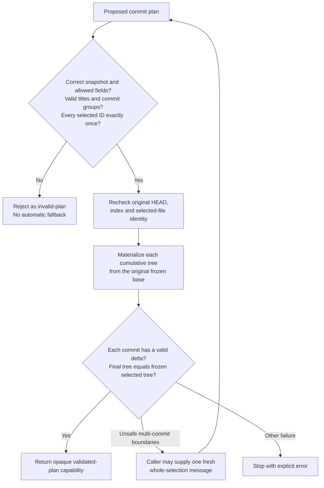
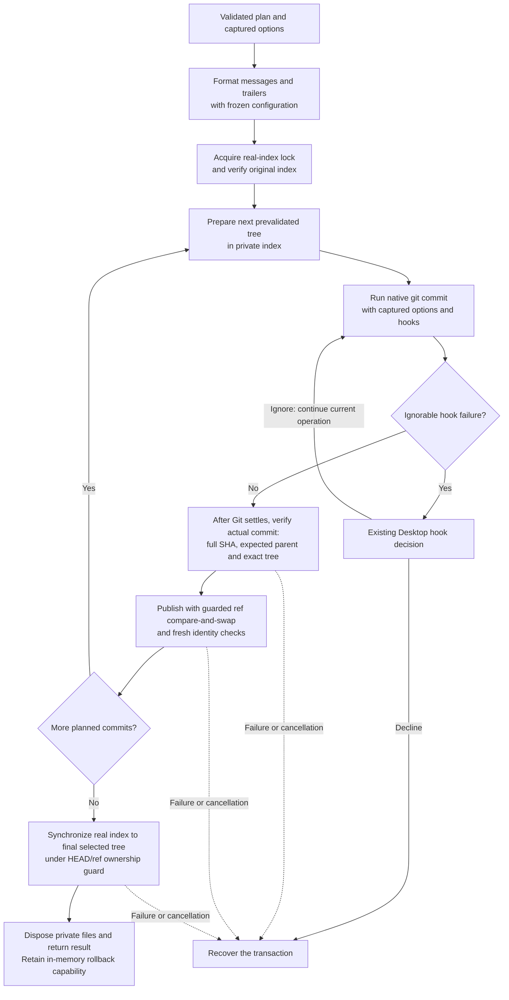
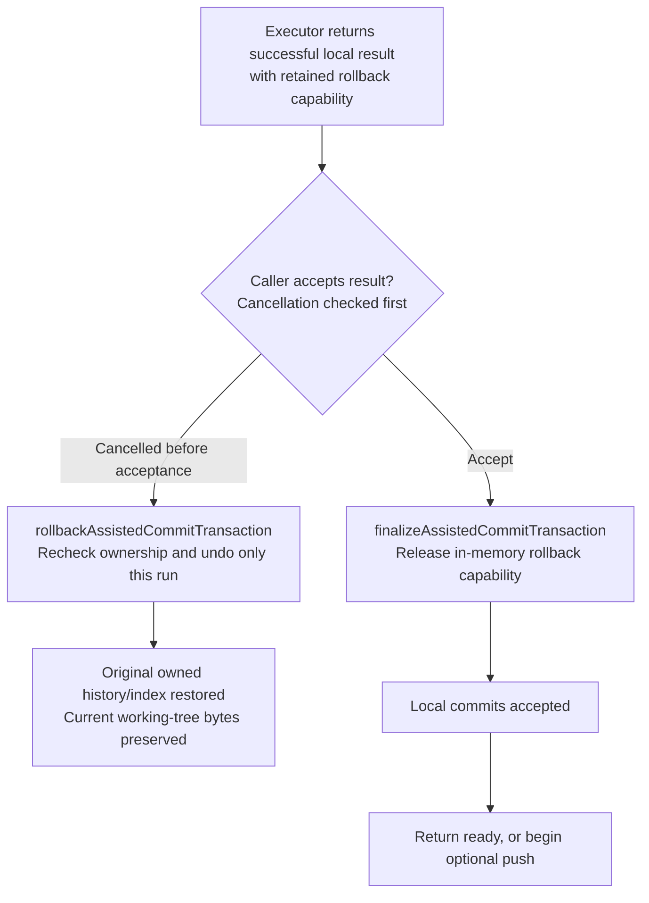
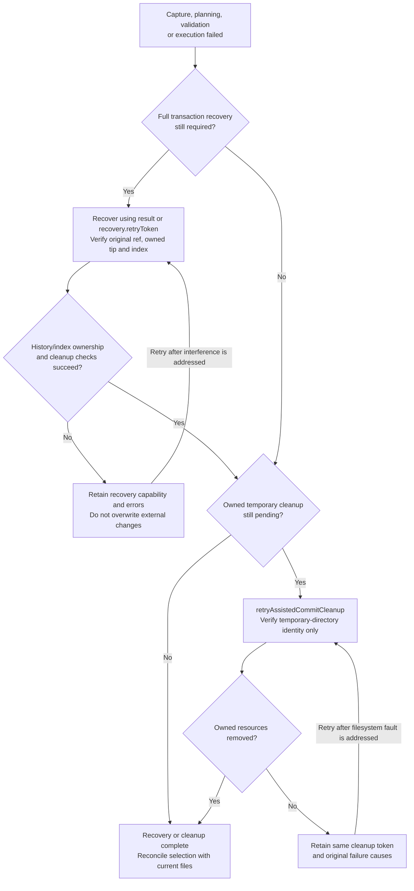

# Copilot-assisted commit processes

This guide explains the plan-first workflow and the transaction backend that makes assisted commits safe. Desktop owns all Git operations. The planner proposes commit groups and messages; it cannot edit working-tree files or author executable patches.

## High-level process

Every proposed commit is validated before the first commit is published to the real branch. Optional push happens after local acceptance, outside the transaction backend.

## Freeze selected content

The snapshot freezes content and selection boundaries. Later planning and execution do not reread live files to construct commits. Unselected changes are excluded; selected files are checked in their entirety, even when only some lines are selected. Working-tree bytes and the real index remain untouched during capture.

## Propose commit groups and messages

The planner receives only the analysis view, not private snapshot handles or authority to perform Git operations. Supplied units are indivisible: the planner cannot invent finer hunks, author patches, include unselected content, or edit working-tree files.

## Validate the entire plan

Validation checks both logical ownership and actual Git trees. A plausible JSON plan alone is insufficient. Single-commit fallback is for legitimate uncertainty or unsafe split boundaries, not malformed output, missing IDs, authentication errors, or changed selected content. An explicitly allowed empty commit is the exception to the non-empty-delta requirement.

## Execute verified local commits

Native commits are first created in the private transaction view. Desktop verifies their contents and parents before publishing each real ref update. Working-tree files are never restored or rewritten by this backend. Hook side effects remain current user changes; unexpected hook-produced commit contents fail verification.

Ignoring a hook failure resumes the current native operation through Desktop's hook interception; it does not start an extra planned commit. The diagram abbreviates the hook callback inside that operation. In-flight Git must settle before recovery inspects its actual outcome. The `committed` progress event is not transaction completion: callers must await the executor result.

## Accept or roll back the completed result

Successful execution is not yet irreversible acceptance. The caller retains the option to cancel after the last local commit. Finalization performs no Git mutation and refuses to discard unresolved owned-resource obligations. Once a remote push attempt starts, orchestration must preserve local commits rather than roll them back.

## Recover failures and retry cleanup

Transaction recovery and temporary-resource cleanup are separate capabilities. A cleanup-only capability exists even when capture fails before a snapshot is returned. It cannot change HEAD, the index, or working-tree files, and cannot substitute for outstanding transaction rollback.

For detailed contracts, supported selections, hook behavior and ownership checks, see [Assisted commit transactions](assisted-commit-transactions.md).
