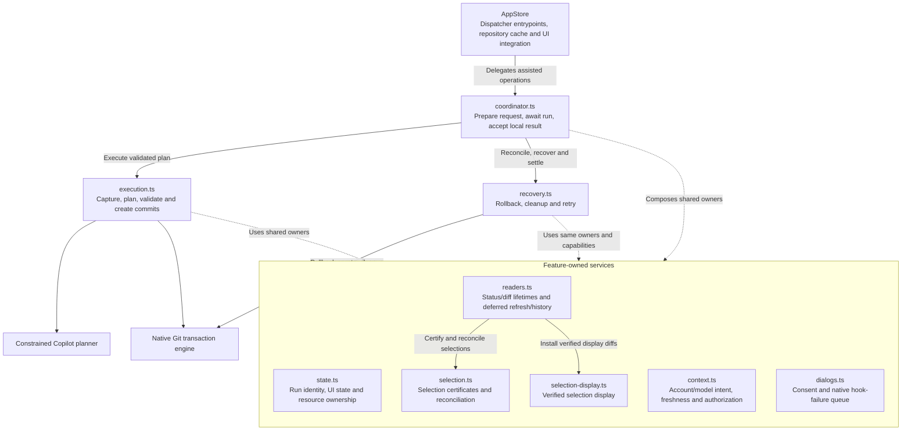
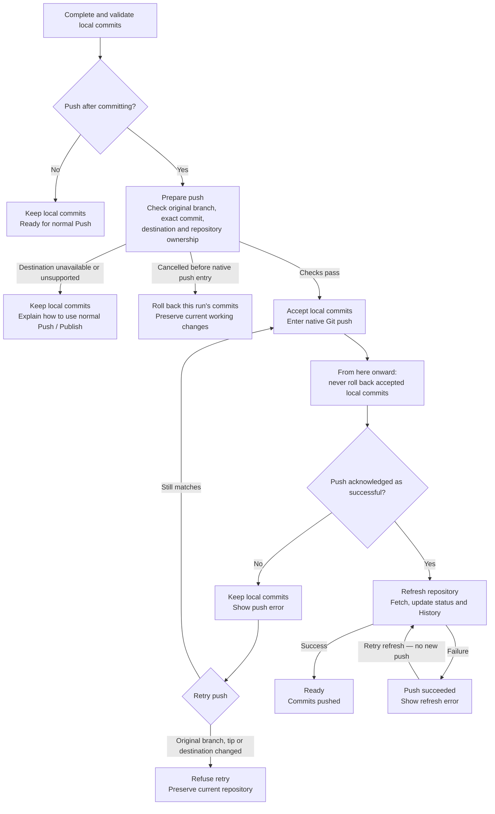

# Assisted commit runs

The Changes action connects the repository-owned assisted mode to an
awaited local transaction, optionally followed by a repository-authorized push.
Ordinary commits,
amend/squash forms, tutorials, and standalone commit-message generation keep
their separate paths.

## Ownership and UI

`ChangesSidebar -> FilterChangesList -> CommitMessage -> Dispatcher ->
AppStore._createCopilotAssistedCommits -> AssistedCommitCoordinator` is the request path. Dispatching the
callback is not success. The returned `AssistedCommitRunOutcome` distinguishes
`local-ready`, `pushed`, `push-error`, cancellation, declined consent, busy
admission, and local transaction errors.
Only a verified executor result can reach local acceptance.

`IChangesState.assistedCommit` is a discriminated state: idle, consent,
preparation/capture, analysis/whole-selection summarization, validation,
committing (zero-based index, total, title), finishing, push preparation,
pushing/refreshing pushed commits, rollback, or error.
The feature coordinator owns the run ID, AbortController, original repository/account intent,
immutable request/options, snapshot, checked plan, result, and retained recovery
capability. Components own only presentation. Switching tabs/repositories or
unmounting the form does not cancel or orphan a run.

The implementation lives in `lib/assisted-commit/`, with distinct owners rather
than additional feature machinery inside AppStore:

| Module | Responsibility |
| --- | --- |
| `coordinator.ts` | First-click preparation, one awaited request, synchronous local acceptance boundary |
| `state.ts` | Exact run identities, UI/error publication, reader obligations and resource admission |
| `context.ts` | Issuing account/model/provider intent, freshness and authorization continuity |
| `execution.ts` | Consent-to-snapshot preparation, complete plan validation, native execution and accepted-plan statistics |
| `selection.ts` | Weak selection certificates, original diff lineage and current-content reconciliation |
| `selection-display.ts` | Verified display-diff installation without broadening selection |
| `readers.ts` | Associated status/diff readers, manual consumption, deferred refresh/history and settlement |
| `dialogs.ts` | Assisted consent and the shared owner-aware native hook-failure queue |
| `recovery.ts` | Composed recovery functions over those owners; no second run or capability registry |
| `push.ts` | Frozen destination, native push continuation, publication and push-only retry |
| `push-ownership.ts` | Original-owner and alias fences shared by accepted readers and recovery |

This diagram shows module responsibilities and collaboration, not an exhaustive
import graph. Dashed links represent shared lifecycle services.

AppStore retains existing repository cache publication, conflict/menu updates,
ordinary operations and Dispatcher entrypoints. Its repository port supplies
only existing refresh, full refresh, History loading, commit/push-stat recording
and the shared native push pipeline. A current configuration reader, the shared model resolver and
synchronous change/error notifications complete the integration. No owner
receives AppStore or accesses its private members. Native engine capabilities
remain the same objects throughout execution, cleanup and retry; extracting
ownership does not serialize, copy or reconstruct them.

Local-only acceptance finalizes the verified native result synchronously
after the last cancellation/authorization check. Optional push keeps that result
reversible throughout preparation and finalizes it only inside the synchronous
native before-mutation fence, immediately before the remote attempt. It never
accepts merely because the executor returned. Accepted bookkeeping clears full
rollback and cleanup-only authority together; push-only retry cannot regain
either capability. Refresh, associated readers and presentation still settle
through their feature owners even when an observer throws.

RepositoryStateCache reconciles assisted state by database ID, independently of
the repository's metadata hash. An alias or refreshed GitHub metadata must not
hide progress, permit a duplicate run, or disconnect Cancel. Distinct repository
IDs retain independent preferences, progress, and errors. The existing
per-repository commit-mode and assisted-push storage supply restart persistence;
active runs and
recovery capabilities are not reconstructed after process death.
Native GitStore publication has one authoritative store per repository ID/path;
obsolete metadata-hash emissions cannot replace a newer tip or local-commit list.
Historical getters route native work to that authoritative store while preserving
newest draft/co-author input revisions.
Path-changing transfers do not forward old-hash writes into the new path.
Old background stores stay isolated and cannot overwrite the moved history.

The animated panel announces concise phases and actual commit indices/titles.
Its existing options control occupies the reserved top-right header area, inside
the same transition/inert wrapper as progress and recovery. The run's busy guard
still disables options without hiding Cancel or replacing error/retry controls.
Manual mode keeps its separate action-bar control and draft focus behavior.
Cancel remains reachable until acceptance and is disabled during recovery.
Push preparation remains reversible; native push entry removes rollback Cancel.
Push failures keep their own inline error and Retry push, even with no selected
Changes or no current Copilot eligibility.
Settled errors are inline, with details using existing error presentation;
unresolved recovery offers Retry rollback, not a dismiss-to-ready escape.
That existing retry also retains a temporary-cleanup capability when capture
failed before publishing a snapshot. Full transaction recovery always takes
priority: removing temporary files alone never acknowledges history, index or
lock recovery. Without a full recovery token, retry removes only the engine-owned
temporary directory through `retryAssistedCommitCleanup`, then reconciles current
selection with read-only Git. A failed cleanup retains the identical capability
and admission locks; success clears only that obligation. Current external HEAD,
index and working-file edits are not rolled back by a cleanup-only retry.
Error state records whether original settlement is still underway. Retry and
Dismiss are disabled in UI and backend until that exact owner has settled; error
publication does not itself release Git ownership.
Required recovery remains reachable independently of preferred Manual/Copilot
mode or current execution eligibility.
Manual fields remain inert/AT-hidden, and their draft is never replaced or
cleared by assisted success, failure, cancellation, or an empty commit.

## Admission, consent, and frozen inputs

Execution preconditions checked by both UI and backend include an authenticated
Desktop-enabled eligible account, SDK permission, and the packaged runtime. The
commit-message model preference resolves to `CopilotModelRequest`, including
BYOK credentials. Assisted commits share that picker and preference rather than
hardcoding a model or effort.

Unknown co-author and filtered-hidden-selection confirmations remain ahead of
execution. Desktop first prepares an opaque, weakly owned first-click intent
with immutable request, repository/HEAD, account/model and file versions.
Warning continuations keep immutable file/line selections,
trailers, and options; a stale continuation cannot silently use a broader set.
The feature context also checks selection, branch intent, mode, amend/conflict state,
options, and account intent after awaited preflight steps.
Account intent is bound to its issuing credential session, not an access-token
string. Renewal within that session remains valid; replacement sign-in retires
the request even if it reuses the same token. Synchronous binding checks acquire
no tokens, and empty commits bypass credential binding entirely.

Assisted consent has its own `AssistedCommitDisclaimer` and 30-day timestamp,
not the manual-generation disclaimer's continuation or acceptance. It accurately
describes one or more generated local commits and cancellation. Declining starts
no snapshot, model analysis, or history mutation. Local preflight versions read
only selected filesystem metadata (not file contents/diffs or a Git snapshot),
so consent/keychain waits can reject newly edited selected files. These versions
are conservative freshness checks, never executor authority.
Every requested partial mask is also certified against its retained Desktop
diff basis before those versions become first-click freshness. This local
selection verification is not AI analysis or transaction snapshot capture;
read-only diff commands cannot stage or refresh the real index. Verification
repeats before capture and before authorizing the captured capability. Changed
or unverifiable initial masks require reselection, not a fresh numeric remap.
Retained bases include their original selection shape. Display refresh in
eligible assisted mode validates initial line selections before changing
selectable bounds. Incompatible views are excluded for reselection. Lineage
also survives derived `All`/`None` shapes across mode/fallback transitions, so
implicit whole-file promotion cannot bypass backend certification later.
Only explicit user selection updates establish a new basis; refresh never
manufactures a basis for an unverifiable partial mask.
An authorized snapshot temporarily owns retired UI masks while reconciliation
installs current selection authority; that handoff is not an unverifiable new
selection. Settled presentation-only errors are not read owners, even when an
ownerless reader temporarily marks their presentation as settling.

After admission and consent, the transaction engine freezes and verifies exact
selected bytes, identities, line selections, HEAD, and original index. Only
snapshots matching the original preflight versions and complete intended HEAD
can proceed to planning; an internally consistent newer capture is not authorization.
Only
`snapshot.analysis` crosses the planner boundary. The
[assisted commit planner](assisted-commit-planning.md)
validates the entire plan and every cumulative tree before execution. Its
uncertainty/valid-unsafe-split fallback requests a fresh whole-selection message;
invalid output, quota/auth failures, stale content, or observer errors never
trigger fallback.

Generated messages are checked against applicable repository rules before any
commit, including configured trailers/sign-off, author/committer email and branch
constraints.
Validation reads the snapshot's frozen identities/configuration, not newer live
Git settings. Complete raw native commit messages/identities are checked again
before each created object is published, including hook-modified messages.
Display-oriented truncated summaries/bodies and synthetic separators are never
used as validation input. Prepared custom-model intent also freezes non-secret
provider/model definitions; deletion or modification fails rather than silently
switching an assisted request to the default model.
Provider and credential revisions are frozen before awaited preflight, checked
through planning/publication/acceptance, and changes abort affected active runs.
Empty commits bypass this model/credential continuity check entirely.
Native message prevalidation uses hook-free, signing-free private commit
metadata under the already-validated plan. It changes no real refs or index and
does not count as a user commit. This gives exact `git commit --signoff` and
cleanup semantics rather than approximating sign-off with configurable
`interpret-trailers`. Temporary message metadata is snapshot-owned and disposed.
Messages are not wrapped, truncated, or otherwise rewritten beyond the existing
Git message/trailer conventions. Every generated commit receives the same
captured co-authors, sign-off, and skip-hooks options.

With no selected changes and Allow empty commit enabled, Desktop validates one
explicit plan titled exactly `Empty commit`. It performs no model request,
credential resolution, AI consent surrogate, or title prompt. Hooks may run;
a hook changing the required title causes rollback. Allow-empty resets only at
accepted success, and the manual summary/description remain unchanged.

## Coordinating Desktop Git activity

Git mutations sharing overlapping working files or Git metadata are conservatively
serialized, including parent checkout and cross-worktree branch rename. Unrelated
repositories retain independent state and execution. Existing input restoration
(Undo/amend/co-authors) advances the shared input revision just like manual edits.
Mutation admission resolves each caller's working, Git, common and object
directories, including transitive native/environment-provided alternate object
stores and peer linked worktrees outside the main checkout. Git resolves the
alternate dependency graph; Desktop does not change its environment or config.
Cleanup
snapshots become selection authority only after original first-click binding
succeeds; rejected captures cannot authorize replacement-content selections.
Complete resource-set ownership allows nested operations from the same caller,
such as ordinary create-and-checkout in a linked worktree. Observer callbacks
inherit neither Git nor destructive-resource ownership. Locate guards a missing
old path without querying vanished Git metadata, then guards the chosen path.

`git/repository-operation.ts` supplies per-canonical-path leases and tracks full
operations plus their Git subprocesses. Acquisition blocks new writers, then
drains already-admitted work before capture. It never kills a status reader or
reads around an in-flight index mutation.
The coordinator rejects already-admitted mutations before registering an assisted run.
This keeps ordinary compound operations intact, rather than letting a new
preparing/consent owner interrupt their later checkout. Low-level acquisition
still drains complete admitted readers; new mutations never queue behind a run.
Ordinary mutation reservations are not exclusive destruction locks: background
fetch does not newly prohibit an otherwise-enabled manual commit or checkout.
Both kinds register complete lifetimes for reciprocal assisted admission.
Worktree add/read/switch and paired local name/email writes run through
Dispatcher/AppStore as whole operations. Worktree add/move guard canonical
destinations as well as source resources.
Worktree removal retains the upstream missing/force/deferred-checkout options.
Its reservation covers the follow-up checkout through actual settlement.
Shared ancestry checks handle filesystem roots without doubling separators,
including Windows drive roots, while retaining canonical case normalization.
Clone operations reserve their destination before preparatory Git/auth/progress
work and retain canonical protection through recursive checkout. Clone dialogs
disable affected destinations and revalidate after remote-info waits.
Local-path and `file://` clone sources also retain read operations through the
complete clone, including their physical aliases, shared metadata and peer
worktrees. They wait for an assisted source run to settle rather than copying
transient commits that may be rolled back. Network and scp transports retain
Git's existing transport selection.
File URL mapping follows native Git rather than browser URL normalization:
Windows preserves authorities (including `localhost`) as UNC servers and accepts
local drive forms such as `file://C:/repo`; POSIX Git ignores authorities.
Percent decoding precedes path parsing, while literal `#`, `?` and `+` remain
path characters. Source coordination protects that native path without rewriting
the URL passed to Git.
Native clone subprocess ownership derives from its explicit destination, not
the application's execution cwd. Relative destinations follow native cwd
resolution, and unrelated clones remain independent of an assisted checkout
containing the unpackaged application. Other commands retain cwd ownership.
Read-only global configuration queries used during clone preparation have no
worktree admission resource: they cannot refresh its index and must not wait
behind the application checkout's lease. Global mutations remain guarded.
Configuration classification parses genuine flags and their operands once per
decision. Literal values after `--`, including `--get` or `--list`, never grant
read-only admission.
Repository creation likewise runs through Dispatcher/AppStore with a complete
destination reservation. Initialization, registration, template writes and the
initial native commit keep ownership even after dialog dismissal/unmount.
Creation options are frozen before those awaits; protected destinations are
disabled and rejected before filesystem writes.
UI selection/dismissal runs after native creation ownership ends. Error handlers
leave both Git and destructive authority; delayed continuations retain no
destructive privilege once their exact operation token has finished.

AppStore mutation entrypoints and GitStore operations participate in this
coordination. Competing commit/amend/checkout/rewrite/discard/network/worktree
operations fail rather than queue a delayed mutation. Selection/options/mode
changes are likewise guarded, in addition to disabled UI, history actions,
menus, and toolbar controls.

Status/diff/indicator refresh requests coalesce during the owned scope. Other
readers defer until release. Full reader lifetimes are tracked so an existing
refresh cannot schedule an untracked index-refreshing subprocess after capture.
Transaction observers and UI emissions explicitly leave async operation
ownership; an observer cannot inherit permission to mutate the repository.
That includes streamed terminal chunks, GitStore updates, and AppStore errors.
Worktree move/delete operations guard both their command repository and target
worktree; another worktree cannot remove a running transaction's files.
Destructive parent/main-repository removal also guards every protected worktree,
Git directory and shared common directory, including a linked worktree outside
the main repository's filesystem tree.
Move/delete/discard guards cover affected directories and active descendants,
not just command cwd. They also protect files inside active roots, using
bidirectional overlap, and refuse admission against in-flight affected paths.
Deferred readers capture run association before waiting;
they cannot lose exclusion policy when the live run map is cleared.
Associated selection readers retain mutation admission and UI protection for
their complete verification/publication lifetime, even after the Git lease
releases. Settlement drains those readers before reusable admission. These reads
use command-local optional-lock-free strict error propagation; failures remain
inline and retryable rather than becoming quiet cancellation.
Status requests waiting behind sealed settlement carry only their exclusion
policy into the resumed read, not the old run's ownership or recovery fences.
Newly observed rows remain unchecked; ordinary later refreshes keep existing
behavior. A replacement run uses its own association, and the stale request
cannot clear its partial selections.
Physical working/Git/common/object protection is separate from the Git lease:
finalization does not remove it while readers or locked refresh recovery remain.
Related repositories' backend and UI admission use that same protection.
The context uses public async-hooks resource callbacks rather than Node's
AsyncContextFrame-backed AsyncLocalStorage, which can fatally crash in an
Electron renderer realm. This is exercised against the production Electron app,
not just Node unit tests.

Reconciliation inside the retained result/recovery scope uses command-local
`GIT_OPTIONAL_LOCKS=0`. Neither process.env nor Git configuration is changed.
Required assisted readers propagate errors rather than using GitStore's
ordinary success-shaped failable-operation defaults.
This prevents benign Desktop status refreshes from invalidating the original or
installed index. The engine continues its selected-file checks; unselected
working-file edits remain allowed and uncommitted, and are observed afterward.
Remaining/newly observed changes are excluded after success rather than being
automatically selected for the next assisted action.

## Cancellation, hooks, and recovery

Cancellation is cooperative: the run owner aborts its controller and settles only
its owned consent/hook popup. Native hook interception can stop a running hook;
Desktop still awaits the actual Git outcome before rollback. Ignore continues
the current ignorable hook failure, not a run-wide hook bypass. Later planned
commits still run hooks unless the user selected bypass up front.

All native hook failures, including ordinary commits and pulls, share one
owner-aware popup queue. Assisted failures retain their run-owned popup ID, so cancellation/dismissal cannot
close an unrelated dialog or leave a callback promise unresolved. Declining a
hook recovers the whole local run. Account/sign-in/token/policy revocation aborts
active work and remains an authorization error rather than a quiet cancellation.
Each resolver belongs to one immutable failure identity; stale repeated
settlement cannot remove or strand a later prompt.
Error cause traversal retains domain, SDK, billing, aggregate, cleanup, and
recovery identities, including wrapped cancellation and 402 display metadata.

The executor's `committed` progress is not completion. Even after successful
execution, the run owner retains the result's original-index backup through awaited
reconciliation and calls `verifyAssistedCommitTransaction` to recheck selected
content, full HEAD identity, and installed index. Cancel or selected-content
mutation here rolls back the successful result before acceptance.

Verified rollback restores only run-created history and the original index;
it never writes old bytes to the working tree. Original selections are restored
when independently verified unchanged, not inferred from an error code.
Mutated text selections are reconciled by original HEAD/content
anchors against the current diff, not stale unified-line offsets. Ambiguous,
atomic, renamed, removed, or changed-identity content remains excluded with a
review/reselection message. Newly observed unselected content stays excluded.
Partial restoration always compares canonical and displayed diffs, even when
selected-file metadata is unchanged: unselected attributes or textconv settings
can change display offsets without changing selected bytes.
Restored selection objects retain weakly owned canonical diff, full HEAD and
backing-version authority. Every later display installation verifies that
authority before updating selectable bounds; changed display/content is excluded,
never promoted implicitly to whole-file selection.
Whole-file and atomic restoration also retain HEAD/backing-version authority.
Newly authorised snapshots and successful Manual commits consume old UI
authority; failed commits retain it. Rollback creates fresh current-content
authority instead. Per-file partial masks retain their displayed diff basis when
created, independently of whichever row is currently visible. Pre-capture
cancellation and decline verify those individual bases without dropping
unchanged nondisplayed masks. Display certification uses actual whitespace
options, excluding unsupported views into a settled review state.
Reader failure invalidates uncertified restored selections even after the
original run is gone. Certified rows merge into the latest status rather than
overwriting unrelated newly discovered rows.
Manual commits consuming restored selections defer their selection readers
through the actual native commit and hooks. Success retires the consumed
authority before releasing those readers; failure retains it for verification.
An in-flight post-commit hook therefore cannot make the commit's own HEAD change
look like unauthorized selection drift.
After resource discovery, the admitted reader-gated Manual scope rechecks the
captured masks against current selection/status and certifies their original
HEAD/diff/file versions before any native staging. A refresh that invalidated
those masks during admission cannot authorize them again merely by finishing.
Certified restored partial diffs also follow the native Manual staging path.
After message/unstaging awaits, patch formatting uses that verified diff rather
than applying old numeric masks to a freshly fetched diff. Later unselected
edits remain in the working tree and cannot become committed selected lines.
Ordinary selections without restored authority retain their existing staging
behavior.
Ownerless refresh and commit admission certify every retained restored selection,
including nondisplayed files. Refresh-only restoration likewise merges checked
selections into current rows/status rather than reinstalling a captured list.

Interfered or failed recovery retains its real engine capability in the feature owner,
the original cause and recovery metadata in state, and an explicit retry action.
Retry performs recovery/reconciliation only: no new planner, commits, or push.
External ref/index changes are never overwritten to manufacture ready state.
If rollback succeeded but status/selection reconciliation failed, the error
instead offers Retry refresh and retains the original cause; cancellation cannot
suppress that independent failure.
After verified rollback and cleanup, Retry refresh reconciles against the current
HEAD, not a requirement to return to the original branch. If the branch or commit
has changed, original selections remain unchecked and require review. HEAD must
remain stable throughout reconciliation. Unresolved native recovery still retains
its original history fence and capability.
Unreconciled refresh errors still lock new commits and cannot be dismissed to
reuse stale selections. Metadata-hash transfers redirect old and current cache
representations to reconciled content while preserving draft inputs.
Pull request preview is disabled while an assisted run or recovery locks the
repository. Stale preview requests and file-selection reads are ignored before
querying Git, including when a physical lease protects an otherwise idle view.
Restored selections carry a full-HEAD/file-version fence through deferred reads.
Every pre-capture exit, including Cancel and declined consent, independently
checks first-click freshness. Settled failures resume ordinary diff readers;
retained snapshot existence does not itself keep the UI frozen.
Uncaptured exits recheck versions after awaited HEAD/diff verification and carry
the same fence through teardown. Verified cancellation explicitly resumes the
current Changes diff as well as deferred History visualization.
Uncaptured exit reads use already-acquired ownership rather than waiting behind
their own lease. Required coalesced reconciliation finishes before acceptance;
an optional post-accept refresh failure retains accepted outcome/statistics and
offers refresh of current accepted state, never pre-run selection restoration.
Retry and dismissal deregister the exact old owner before publishing idle, so a
synchronous subscriber may safely start another run. Automatic history file/diff
loading deferred during retained result ownership resumes as a strict read after
release, even under retained refresh protection and when the already-selected
SHA remains unchanged. Failed visualization requests remain deferred until
success or explicit supersession. This optional visualization keeps ordinary
error handling separate from accepted transaction results. Accepted statistics
settle before optional History/error notification delivery; throwing observers
cannot reject an already accepted outcome or skip its bookkeeping.
Initial and retry publication run inside cleanup-protected ownership scopes.
Cancel records its idempotency flag before abort effects and notifies observers
afterward; notification failure cannot prevent signal/popup/hook cancellation.
Reader settlement drains and verifies until quiescent, then seals admission
before its final await returns. New reads coalesce until settlement completes.
Repeated invalidation retains existing causes, including SDK/billing metadata.
Deferred nonselection refresh failures use the same cause-preserving transition.
Mandatory teardown/completion bookkeeping is cleanup-protected independently
from error-notification delivery.
Final optional delivery is protected for cancellation, declined consent and
failed runs too. Verified settled outcomes stay controlled; existing errors
retain notification causes without restoring a removed owner or affecting a
replacement run. Deferred History waits for every unfinished/recovery owner,
not just owners with a successful executor result.
Verified cancellation and declined consent publish idle only after mandatory
reader/resource settlement, through guarded final delivery.
Successful retry publishes idle only through this settled delivery path, after
exact-owner deregistration and mandatory cleanup.

## Local acceptance boundary

`acceptVerifiedAssistedCommitTransaction` is the explicit local acceptance fence.
It holds parent-owned HEAD, full branch-ref and real index locks while completing
verification and the synchronous final authorization/cancellation check.
Recovery ownership is finalized while those fences remain held; a fence-cleanup
failure reactivates retained recovery. The closing UI phase disables cancellation
because this accepted boundary cannot be interrupted. `acceptLocalAssistedCommitRun`
then resets allow-empty/appropriate filters and returns to idle after owned
cleanup. Per-commit statistics count accepted commits, not rolled-back progress.
Final selected-content reads are followed by a complete backing-version vector
before the synchronous boundary; an earlier selected file cannot expire while a
later file is being read.
A final non-yielding metadata-only check closes the asynchronous sampling window.
Synchronous filesystem access is limited to this short acceptance fence; content
capture and all other transaction I/O remain asynchronous.
Post-accept presentation failures preserve truthful local-ready outcome and
accepted statistics. They never invoke pre-run selection restoration or rollback
after finalisation.
Ordinary Manual completion also treats a failed statistics write as nonfatal,
logging it without skipping draft/options/status/history success bookkeeping.

## Optional push and retry

### Opt in once per repository

**Push after committing** lives in the assisted options menu beside co-authors,
sign-off, bypass commit hooks and allow-empty. It defaults off and never affects
Manual commits. AppStore/Dispatcher save only a boolean under
`assisted-commit-push-<repository ID>`; missing or invalid values mean off.
Aliases, metadata refreshes, path moves and rebuilt caches retain that ID's
choice. Other repository IDs keep their own choice; no global/manual setting
is migrated.

The first confirmed action freezes this choice separately from snapshot options.
It also freezes the original branch, upstream/default remote, single push URL,
effective configuration and physical working/Git/common/object directories.
Changing options during a warning cannot silently add a push, and switching the
visible repository cannot redirect the run.

### Follow the commits through the run

This diagram focuses on what happens to local commits and what each retry does.
The configuration and filesystem safeguards behind these decisions follow below.

The first push's normal follow-up includes fetch, branch fast-forwarding,
protection refresh and status/History delivery. The diagram's **Retry refresh**
arrow means finishing retained publication and local reconciliation/readers,
not replaying that whole network sequence. Neither retry contacts Copilot or
creates commits.

Only a completely successful local transaction reaches `preparing-push`.
`prepareAssistedCommitTransactionForPush` keeps its rollback backup while checking
selected content, installed index, full HEAD/ref, cancellation and destination
under parent-owned real HEAD/ref/index locks. Those locks must close and clean up
before spawn. Final backing-file/config/environment, authorization and signal
checks run without yielding immediately before native `git push`; backup
finalization and the irreversible `pushing` transition happen at that boundary.

Before native entry, cancellation rolls back only this run's commits, subject to
the transaction's interference checks: external history/index changes are never
overwritten, and incomplete recovery remains explicit. Rollback
restores index bytes, mode **and original timestamp**: assigning a newer epoch to
old stat-cache entries could falsely mark selected working bytes clean on Git
builds with second-resolution timestamps. Unchanged working changes and their
verified selections must remain recoverable after late Cancel.

After any remote attempt starts, cancellation, sign-out, hook decline,
network/auth failure, rejection or an unknown remote response cannot roll back
accepted commits. The Desktop lease and physical resource protection cover the
whole operation, but native ref/index locks do not span credentials, hooks,
fetch or refresh. There is no token bypass or unlocked live-tip push.

### Distinguish outcomes and retries

| Outcome | Local history and next action |
| --- | --- |
| Push disabled | Accept local commits; normal Push remains available. |
| Optional destination unavailable, unsupported or changed | Keep valid local commits, including `Empty commit`; explain normal Push/Publish setup without creating or publishing a repository automatically. |
| Push failed or remote result unknown | Keep every accepted commit and show the actual push error with **Retry push**. |
| Push acknowledged; follow-up failed | Return `pushed` with `refreshError`; offer **Retry refresh**, never rollback or Retry push. |
| Push and follow-up complete | Return ready with commits pushed. |

Internal outcomes distinguish actual native success, hook abort, preparation/push
failure and post-success refresh failure. A resolved `Promise<void>` from a
fallible wrapper is not success evidence. Original causes remain available in Details; failures
do not launch generic Push retries or contradictory background toast actions.
Final deferred-refresh, selection-reader and History failures are included in
`refreshError` on both initial completion and push-only retry.

The compact panel shows one rounded total native push percentage, using Git's
existing weighted compression/write/remote-resolution estimate rather than each
step's percentage or stderr. Values stay bounded and do not decrease within a
push attempt; LFS/context events cannot reset the estimate. This is push progress,
not an invented total for planning, commits and refresh. After acknowledgement,
the panel switches to **Refreshing pushed commits** without a stale percentage.
Errors show a short summary and the appropriate retry controls. **Details** opens
Desktop's standard error dialog with the full error and retained causes; raw
multiline diagnostics no longer fill the compact panel. The inline summary is
announced once as an alert, not repeated in the polite progress live region.

`_retryCopilotAssistedCommitPush` retains the in-memory intent/result and shares
one in-flight retry promise. It rechecks the exact run, physical owner, branch,
full completed tip and destination. Changed HEAD/ref, replaced directories or
changed remotes refuse retry rather than publishing different commits or deleting
external history; equivalent physical aliases remain valid. Retry does not
capture, analyze, commit, reset options/drafts or count local commits again.
It stays reachable across repository switches without requiring AI eligibility.
Early refusals notify subscribers so the current refusal replaces an old error.

Acknowledged-success errors retain Details/Dismiss even after setup expires,
Manual becomes the preferred mode or AI eligibility ends. The success marker
does not change that saved mode: new assisted execution waits for dismissal,
then the preferred mode resumes. Accepted-commit and verified-push statistics keep
their existing schemas; secondary statistics/notification failures preserve the
primary push error and its retry.

### Use the normal native push pipeline, with a pinned destination

Authentication, proxies, credential trampoline, terminal output, LFS progress and
pre-push interception use Desktop's shared pipeline. The non-force refspec sends
the certified **full commit ID** to the original canonical `refs/heads/...`,
including preexisting local ancestry, not a later live tip. Native pre-push input
uses Git's full-SHA source-ref form with the configured remote, destination and
exact object IDs. Commit-hook bypass never disables push hooks; Ignore resumes
only the current intercepted push, while decline/abort keeps accepted commits.

Command-local parameters pin the raw URL in its original collection: explicit
`pushurl` or fetch `url` fallback. That distinction preserves native
`pushInsteadOf` semantics, which ignore rewrites for explicit push URLs.
The resolved destination is rechecked with those same parameters; rewriting
applies once, and proxies/credentials use the resolved push URL. Neither URL
enters command or performance arguments.

Mirror, force, follow-tags and recursive submodule push behavior are disabled.
Pending tags remain for an explicit normal Push. Assisted follow-up fetches,
including local branch fast-forward fetches, also disable submodule recursion:
a main-repository run has not admitted populated submodules as writable resources.
Ordinary manual fetch/push keep their existing recursion behavior.

### Keep every native operation within the original owner

The following checks protect more than a pathname string. They distinguish
physical resource equivalence from unresolved routes used to reach those resources.

**Admission before discovery.** Requested aliases are certified filesystem-only
before native queries; queries and accepted refresh use the frozen canonical
checkout. Both the requested alias and exact execution path are synchronously
checked, including configuration symlink targets and the alias's current canonical
target. Awaited capture cannot adopt a replacement checkout as its new baseline.

The negative owner certificate is checked before/after awaited pathname resolution
and after lease waits, then retained for later native spawns. This prevents a
substituted checkout from even registering work behind another owner's recovery
lease. Push-retry discovery, lease-free refresh recovery, deferred reads and
selection-reader settlement keep that check; nested scopes cannot drop outer
alias fences. Cross-retargeted aliases cannot query through each other's leases.
Ordinary Push/Pull likewise enter whole-operation admission before metadata or
credentials, rather than queuing a mutation behind an assisted run/retry.

**Resource and route coverage.** Working/Git/common/object identities are frozen
together with linked-worktree `commondir`/`gitdir`, unresolved `GIT_DIR`,
`GIT_COMMON_DIR`, `GIT_WORK_TREE` and `core.worktree` paths and their targets.
Configuration/metadata targets and their exact lock paths undergo foreign-lease
admission before retaining intent and again before acquiring the run lease.
Explicit index/configuration targets reserve their resources and locks, not whole
parent directories. Another owner's external config cannot be borrowed to publish
upstream metadata; valid local commits finish with setup guidance instead.

**Checks through final publication.** Every post-ACK fetch, fast-forward and
refresh spawn rechecks original physical/routing ownership, even after an earlier
follow-up command completed. Deferred refresh from initial completion, push retry
or refresh recovery uses that same frozen owner and independently checks supplied
same-ID aliases. Retargeting stops follow-up with a refresh error, not rollback.

Deferred History retains its accepted owner even after the run leaves the active
map; execution path, deferred alias, native reads and final changeset/diff
publication stay certified. Proven stale requests expire instead of later running
without their owner. Unexpected read failures remain inline and retryable without
duplicate background prompts. Accepted Changes readers also recheck before
diff/selection publication and after filesystem work, including untracked images;
foreign bytes must not appear transiently before a later error clears them.

### Certify configuration without changing Git's meaning

Preparation captures backing versions, then re-reads the complete effective graph
and compares entries, origins and include directives. New dependencies reject
certification, rather than mixing a new parent version with an old target list.
Publication repeats this check before deciding which tracking keys are missing.
Empty/missing includes are dependencies too: adding a rewrite to an empty include
must not change the accepted destination.

Native `git var GIT_CONFIG_SYSTEM` / `GIT_CONFIG_GLOBAL` enumerate defaults and
overrides independently of emitted entries. Thus empty/missing system/global files
are fenced. Overrides retain literal pathnames, including embedded newlines.
Ambiguous default-global enumeration, drive-relative spelling, runtime-prefix
includes (`%(prefix)/...`), invalid/multiple upstream values, multiple push URLs,
missing remotes and unsupported lookups such as global/system-only remotes make
optional push unavailable, not valid local execution.

Native path resolution preserves unresolved `..` traversal across symlinks instead
of lexically collapsing it. Environment comparison respects Windows
case-insensitive names, including indexed config overrides, and POSIX
case-sensitive names. Entry and follow-up proofs retain `LOCAL_GIT_DIRECTORY`,
which selects Dugite and its default system config. Assisted config queries and
remote enumeration clear command-only `GIT_CONFIG`, so they see the same effective
configuration as status/Push rather than a config-query-only shadow file.
Ordinary callers keep their existing lookup environment.

Configuration reads use nonblocking regular-file descriptors, verify target/handle
identity after reading and apply the same rule in the final synchronous check.
A FIFO substituted for an ignored conditional include cannot block the renderer.
Nonregular inputs, regular-file ancestors, symlink loops and proven dangling
inputs (including inactive includes) retain their original causes as unsupported
setup. Initially they preserve valid selected/Empty local completion without a
push attempt; after ACK, stale setup expires **after owned cleanup**. Native
not-a-repository results and unsupported remote scopes/include expansions follow
that rule. Unknown command failures and unexpected I/O, including transient `EIO`,
remain explicit retryable refresh errors, never absence or stale-success fallbacks.
Asynchronous capture and final synchronous checks make the same distinction.

### Protect mutable Git metadata and the object graph

Mutable routes are certified separately from contents. Private/common ref and
reflog trees, index, `FETCH_HEAD`, `packed-refs`, native shallow files and
`GIT_SHALLOW_FILE` allow legitimate regular-file creation/content changes and
atomic replacement, but reject symbolic directory redirection, symbolic/shared
hard-link leaves and changed parent routes before native work. Index environment
and exact shallow path/lock admission remain frozen; private/common shallow
aliases are independent. Existing symbolic shallow routes and missing optional
shallow parents require normal Push, without preventing valid local commits.

`info/grafts` / `GIT_GRAFT_FILE` retain original versions and parent routes.
Introduced grafts, loose/packed replacement refs or replacement/namespace
environment changes stop retained native work. Custom replacement prefixes and
namespaces require normal Push review; missing optional graft parents disable
automatic push only. These rules preserve the local transaction's no-grafts
restriction without undoing acknowledged commits.

The original symbolic `HEAD` must directly name the frozen branch and remains
certified for `includeIf.onbranch`. The branch must stay nonsymbolic even when its
value initially came from packed refs. Initial symbolic branch aliases remain
unsupported by the local transaction; introducing one or changing HEAD after ACK
cannot activate different conditional config. External changes and commits remain
intact while follow-up stops after owned cleanup.

Object checks use the native primary/transitive roots, not an invented common
`objects` directory. External stores need no unused default directory. Root
aliases, environment-provided paths and pack/loose/auxiliary subdirectory routes
cannot redirect fetch writes into unadmitted databases. Ordinary object creation,
replacement and immutable object hard links remain valid.

Alternate files (including missing/transitive `objects/info/alternates`) keep
immutable versions from one consistently discovered graph. Raw literal edges and
`GIT_ALTERNATE_OBJECT_DIRECTORIES` keep their physical targets too; native discovery
still defines the graph. Versions are captured before edge enumeration and edges
are re-read under the same file/path fences, catching drift even between aliases
to the same root. Graph changes stop work rather than widen ownership.

Ignored missing/unresolvable alternate diagnostics, quoted alternate lists and
non-UTF-8 alternate files make optional push unavailable while preserving the
diagnostic and valid local commits. An ignored route cannot activate later outside
the frozen graph. Garbage-entry warnings do not indicate omitted routes and keep
their existing behavior, as do ordinary local operations. Object-route inspection
uses bounded iteration and a shared **4096-entry budget** across admitted roots:
each distinct root and each discovered file or subdirectory counts once per
verification. Initial excess preserves local completion; later growth stops
follow-up without revoking acknowledged success.

### Publish upstream metadata atomically after ACK

For a new branch, Desktop sets its original upstream after verified remote success,
before follow-up fetch. Under the real configuration lock it reads tracking values,
appends missing keys to original bytes in memory with the transaction engine's
quoted-value escaping, and asks Git's native parser over stdin to verify each
exact value. Both keys install by atomic replacement only after validation.
Comments, formatting and absent final newlines survive; failed validation changes
neither original value.

After the lock handle closes, synchronous identity/exact-byte checks immediately
precede installation. The byte-check descriptor opens nonblocking, verifies its
regular-file type/device/inode against the owned lock and closes in `finally`;
pathname ownership is rechecked after reading. Original config bytes use the same
descriptor-validated reader and are recertified before use. Neither a FIFO nor a
same-byte foreign replacement can be adopted, installed or deleted as our lock.

Publication keeps original working/Git/common/object, route and configuration-owner
proofs through every await. Empty/missing worktree config is fenced separately
from common `config.lock`, so staged common keys cannot overwrite a concurrent
worktree tracking choice. The canonical branch and `packed-refs` are fenced before
sampling accepted HEAD through installation. The unresolved common `config` alias
is captured separately from Git's symlink-resolved absolute path; retargeting it
expires setup instead of installing into a retired target. External writers'
tracking choices and history are never restored or rewritten.

Only exact bytes installed by the owned transaction advance the retained config
proof. A hook/external writer changing `core.worktree`, includes, other config
bytes or routing inputs stops subsequent native reads/mutations, preserving ACK
and history. Metadata version/routing mismatches have domain identity distinct
from filesystem failures: even final-check `EIO` retains Retry refresh and the
publication obligation. Successful cleanup alone cannot turn unproven I/O into
permission to abandon setup.

### Settle cleanup before releasing ownership

Unfinished tracking metadata and owned locks remain explicit in-memory obligations.
Retry refresh renews original Git admission and completes only that tracking intent
and reconciliation, never another push or a different current tracking choice.
Changed original branch/tracking, removed remote, unsupported symbolic HEAD/refs
or proven broken routing expire stale setup only after owned cleanup. Protection
then releases with dismissal/manual setup available; remote success and all
local history remain. A stale cause never discards a lock whose cleanup failed.

Cleanup admission uses the retained original resources **before current Git
discovery**. A weakly owned original routing proof can then classify broken or
substituted owners/aliases as stale; invalid `commondir` must not strand accessible
original locks. Publication creates no private staging directory, marker or staged
config file and needs no recursive cleanup. Its only cleanup resources are the
exclusively created native `config.lock` handle and registered identity, never an
unrelated folder at a temporary pathname.

Snapshot cleanup is a separate obligation: an opted-in run cannot advance while it
is pending. Capture can retain a cleanup-only token before a snapshot exists;
recovery retries only that owned temporary cleanup and reconciles current
selection, without planning, committing or pushing. Full transaction recovery
takes priority. Acceptance clears obsolete cleanup and rollback authority
together; push failure cannot reactivate them after native entry.

### Restart does not resume executable capabilities

Only the repository preference persists. Executable push-retry/rollback
capabilities, credentials and frozen URLs/config are not saved to localStorage.
After restart, ordinary Desktop Push remains available for accepted local commits.
