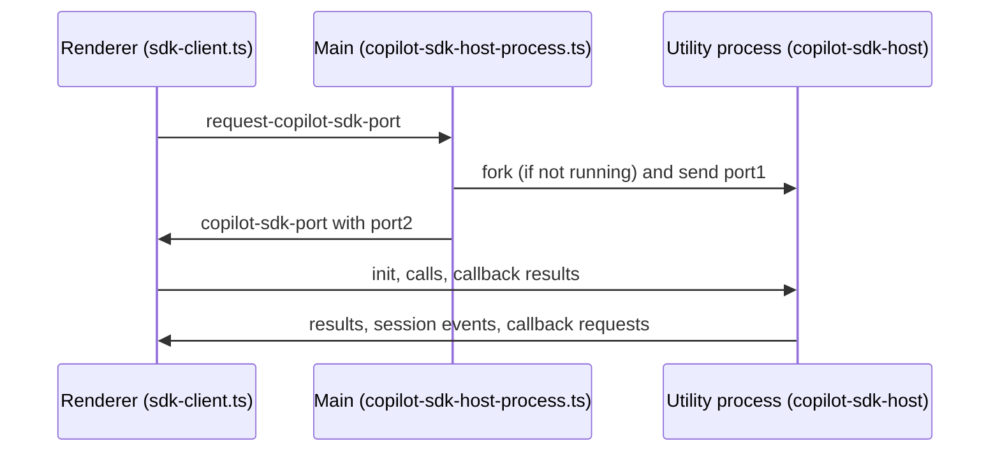

# Copilot SDK host process

GitHub Desktop runs the Copilot SDK (`@github/copilot-sdk`) in a dedicated
Electron utility process instead of the renderer. The renderer uses thin
proxies of `CopilotClient` and `CopilotSession` that forward each call to the
real SDK over a message port.

## Why

The SDK uses Node's `AsyncLocalStorage` (since 1.0.30-preview.0 it wraps every
inbound JSON-RPC message in `AsyncLocalStorage.run()`). In the renderer that
can kill the process with:

```text
Fatal error in V8: Isolate::PushStackTraceAndDie null prototype chain root
```

The root cause is in V8, not Desktop, the SDK, Node or Electron. V8 has one
per-isolate slot, the "continuation-preserved embedder data" (CPED), which
follows async continuations. In an Electron renderer it has two users:

- Node's `AsyncLocalStorage` (the AsyncContextFrame implementation, the
  default since Node 24) keeps its current frame, a JavaScript `Map`, there.
- Blink's task attribution stores a C++ `CppHeapExternal` there while it runs
  attributed tasks, such as input event handlers (clicks) and
  `scheduler.postTask` callbacks.

Node reads the slot through V8's `getContinuationPreservedEmbedderData`
builtin, which returns `undefined` for non-JavaScript data. V8's optimizing
compilers drop that guard: TurboFan
(`JSCallReducer::ReduceGetContinuationPreservedEmbedderData`, lowered by
Turboshaft to a raw load) and Maglev
(`MaglevReducer::TryReduceGetContinuationPreservedEmbedderData`) replace the
builtin call with a raw load of the slot. Once `getStore()` is optimized, a
call inside a Blink-attributed task receives the `CppHeapExternal` as its
frame, and looking up a property on it aborts V8.

This reproduces without Desktop or the SDK on Electron 44.9.1, 44.11.4, 45.3.4
and 46.0.0-alpha.11. It doesn't reproduce cold, with
`--no-maglev --no-turbofan`, or with `--jitless`. It also reproduces in plain
Node when a native addon puts non-JavaScript data in the slot.

A utility process has no Blink, so nothing else writes the slot, and the SDK
can use native `AsyncLocalStorage` as intended. It also keeps SDK work and
crashes away from the UI. The main process was ruled out because SDK work
there would block the UI and an SDK crash would take down the whole app.

Desktop previously shipped a renderer-only workaround that replaced the SDK's
`AsyncLocalStorage` with an `async_hooks`-based implementation at bundle time.

## Architecture



- `app/src/lib/copilot/sdk-client.ts`: renderer `CopilotClient`,
  `CopilotSession` and `RuntimeConnection` proxies. Import these instead of
  the SDK; ESLint only allows type imports from `@github/copilot-sdk` in
  `app/src`.
- `app/src/lib/copilot/sdk-host-protocol.ts`: the message types and the
  encoding of callbacks and errors.
- `app/src/lib/copilot/sdk-host.ts`: serves one client over a port.
- `app/src/copilot-sdk-host/index.ts`: the utility process entry point.
- `app/src/main-process/copilot-sdk-host-process.ts`: starts and stops the
  utility process and hands out ports.

Each `CopilotClient` gets its own port and SDK client. All clients share one
utility process, which starts with the first client. When it has had no open
ports for a minute, it tells the main process, which stops it unless a new
port is in flight. Stopping a client (`stop` or `forceStop`) closes its port;
if a port closes while its client is still running, the host force-stops it.
If the utility process exits, every pending call rejects.

## Differences from the SDK

- Only the subset of the API Desktop uses is proxied. `rpc` calls are
  forwarded by path, e.g. `client.rpc.account.getQuota()`.
- Callbacks in client options and session configs, such as
  `gitHubTokenProvider` and `onPermissionRequest`, run in the renderer and
  always become asynchronous.
- `createSessionFsProvider` isn't supported. The host gives every session an
  in-memory filesystem (`copilot-in-memory-session-fs-provider.ts`) when the
  client is configured with `sessionFs`, and disposes it when the session
  disconnects or the client stops.
- Errors keep their name, message, stack and `code`, but not their class.
- Session events are delivered asynchronously, in order, and before the result
  of the call that caused them.

## Tests

Unit tests can serve clients in-process with `setCopilotSdkConnector` and a
`worker_threads` `MessageChannel`; see
`app/test/helpers/copilot-sdk-host.ts`.
